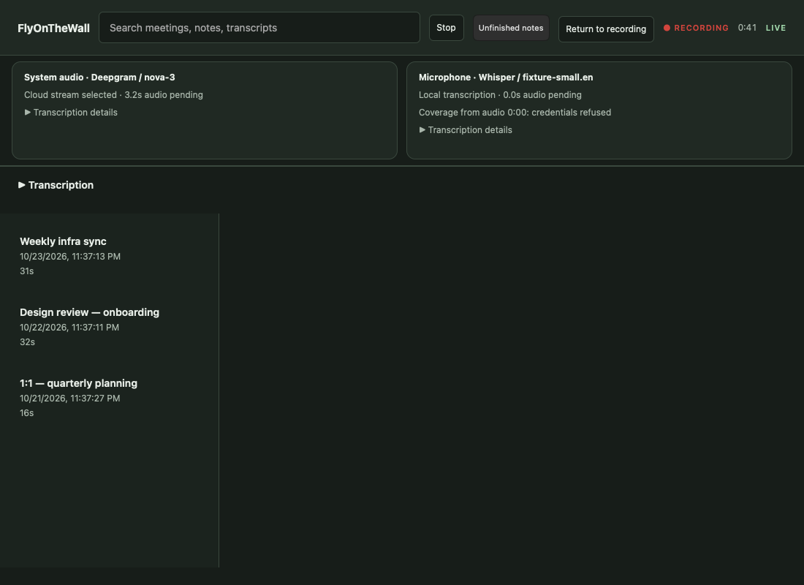
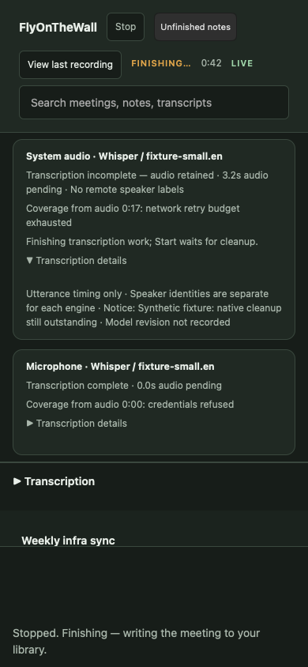
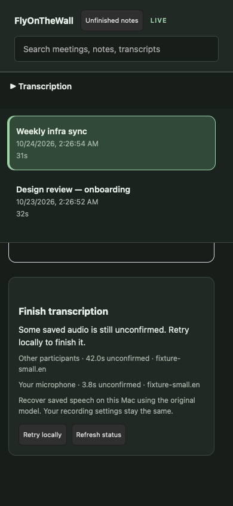
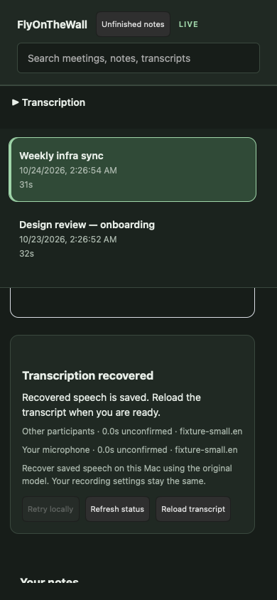

# Durable speech handoff runtime

## Local-only recording and restart

Local-only recording now writes the same canonical 16 kHz source input and
coverage journal used by durable fallback. Its first provider epoch is local,
with no switch reason. Each source retains its original session offset, endpoint
policy, language and model revision. `LocalSourceConfig` has no cloud transport
or credential fields; a failed local model cannot silently select a provider.

Before capture, an owned preparation task resolves file identity. Native model
loading remains on the source worker after capture starts. Known files must
match their published checksum; custom files are pinned to their SHA-256. The
worker checks the pinned file before and after native creation. An unavailable
model still permits audio recording and emits a source error. For a known
catalog model, the saved revision is its expected published checksum even when
the file is unavailable; this identifies a later recovery candidate and does
not assert verification or native readiness. An unavailable custom file has no
invented revision.

Local Stop waits for inference publication under its bounded deadline. Data
owners release before native destruction, allowing finished audio to be saved
while cleanup remains visible. A separate per-source `stt-native.lock` stays
held through actual native destruction, excluding overlapping restart. The
recorder continues refusing a new recording while that native worker remains
alive. A blocked constructor or inference call cannot be forcibly interrupted;
Stop can time out while the original audio and canonical input remain retained.

The local durable path preserves microphone overlap instead of applying the
old suppressive echo gate to its canonical input. Transcript deduplication is
unchanged. This does not enable acoustic echo cancellation; live processing
integration and physical overlap-quality acceptance remain unfinished.

Device-free tests cover exact retained input and restart after inference
failure, initialization deadlines, cancellation before capture, data/native
ownership separation and the actual session recording path. The macOS opt-in
`installed_local_only_session_preserves_public_audio_and_its_verified_restart_identity`
test uses `FOTW_NATIVE_LOCAL_MODEL` and `FOTW_NATIVE_LOCAL_WAV`, verifies the
approved small.en/JFK hashes, and opens no physical capture device or provider.
One uncontrolled-cache run retained all 176,000 samples and recognized all 22
words, with 724,811,776 bytes maximum process RSS and 19.71 seconds whole-process
elapsed time. These are single-source smoke measurements, not isolated inference
latency, concurrent-app resources or representative transcription accuracy.

## Processed input and replay identity

The durable stream can explicitly declare `FailoverConfig::processing` before
source creation. Its backend/version/profile identifiers are validated and
fingerprinted into the canonical audio header. Ordinary sources keep their
existing header bytes and behavior. A declared processed source accepts only
`write_processed` intervals with an absolute source offset, route epoch and
cleaned/original-fallback classification. Untagged, duplicate, discontinuous,
nonfinite, empty and oversized calls accept no new input.

Before appending or exposing processed PCM to an ASR provider, the blocking pump
writes and syncs the source's `stt-processing.jsonl` interval record. Each record
binds the exact quantized PCM with SHA-256. The declaration and records describe
audio processing, independently of the ASR provider epochs. The caller must
archive original capture audio before submitting it to the AEC worker.

Local restart validates the declaration, canonical fingerprint, contiguous
intervals, route epochs and every saved PCM digest under the exclusive source
lease before any torn-sample repair, inference or journal mutation. Reads are
bounded to 4096 bytes per metadata record and 16000 PCM samples per interval;
validation retains only aggregate counts. A missing sidecar remains detectable
from the canonical header. Altered, incomplete, unknown or unsupported processing
evidence is refused without rewriting those files.

Raw reconstruction cannot acquire or reuse an ordinary raw recipe for processed
input, including when processing metadata is malformed or missing. This version
replays fully retained, verified processed PCM; it does not recreate lost cleaned
PCM from original audio or recover a partially written processing interval.
Such sources remain incomplete with retained audio/evidence. Existing legacy
unprocessed recovery retains its current behavior. Older application versions
may refuse the new processed header; existing original-source files are unchanged.

The worker-to-durable-stream test uses generated audio, a fake AEC backend and a
loopback provider. It verifies cleaned and missing-reference fallback samples,
metadata roundtrip and byte-for-byte original WAL preservation. Other runtime
RED/GREEN tests establish tagged-only admission, invalid digest/missing-sidecar
restart refusal, raw-recipe exclusion and validation before PCM repair.

This API does not enable AEC in recording. Capture-clock conversion, native
reference alignment and capture-pump ownership still need integration; backend
quality and physical acceptance remain separate. Per-interval metadata sync cost
has not been qualified for live capture. Existing provider choices and defaults
are unchanged.

## Speech policy and lifecycle

Select `fotwd stt fallback --model <name|absolute-path> [--language <code>]`
to persist an explicit Deepgram preference with an on-device backup. Both CLI
recording and dashboard Start read this choice. Deepgram remains the default;
`fotwd stt local` keeps audio on this Mac. Fallback initially sends audio to
Deepgram and stays local after a provider failure for the rest of the meeting.

Start verifies the backup file, validates its actual model/language metadata,
and prepares independent native states before capture or cloud connection.
Known model filenames must match published checksums; custom files are pinned
to their SHA-256 for recovery identity, without asserting publisher authenticity.
An unavailable backup or missing Deepgram key refuses Start. The dashboard
shows Preparing without a recording clock or red badge and offers Cancel.
Cancellation retains ownership until native preparation finishes; a late result
cannot start capture. Capture admission and cancellation share a synchronized
boundary. Once native capture setup wins that boundary, the UI says Starting
capture and offers Stop, warning that buffered audio may be saved. A late native
start still publishes capture identity/clock even if Stop woke the waiting Start
request earlier. Pending Start requests poll setup every second so Cancel does
not wait for the normal five-second status interval. No model is downloaded
automatically. Startup deadlines retain native ownership for every speech mode;
new Start requests are refused until that setup actually exits. A deadline can
bound the app's wait but cannot force a blocked OS call to return.

The dashboard Transcription panel saves the same policy, model and language.
It reports file availability without treating it as native readiness, validates
local model metadata on explicit save, and preserves the previous policy on
failure. Model work runs outside the library mutex. Summary and export settings
remain independent of speech recognition.

The recording status API and dashboard expose the actual provider/model per
source, verified revision when recorded, original coverage boundary, switch
reason, pending audio and backend capabilities. These describe the active
streams independently of the saved preference for the next recording. A durable
Complete state proves accounted input coverage, not recognition accuracy. Legacy
streams expose their actual connection lifecycle with unknown coverage rather
than claiming zero backlog or complete inference. Local-only streams also
measure worker liveness; cloud-only streams have no native-worker measurement.

Read-only durable status handles retain metadata and atomics, not model or file
leases. After a durable inference timeout, its measured native worker remains
visible and prevents another recording until cleanup finishes. Audio finishing
and library persistence proceed independently. This retained-worker admission
guard applies to both durable fallback and local-only streams, including native
recognizer teardown after a close acknowledgement. The app cannot forcibly stop
a native OS operation.

Saved meeting details expose the primary transcript's actual engine epochs,
recorded revisions and capabilities, switch reasons and confirmed receipt
boundaries. The reader does not load inference payloads or turn metadata into
transcript words. Epochs without receipts have no confirmed processed interval;
older transcripts explicitly have unknown history. A different primary transcript
does not inherit stale source history. Expand **Transcription sources** in the
saved meeting view; all boundaries use the original recording clock, independently
of the transcript's first-speech display origin.

A synthetic saved-history fixture uses real durable projection and the real API:

```sh
cargo run -p fotwd --example ui_preview -- --speech-history
```

Synthetic [desktop](speech-ui/saved-desktop.png) and
[390px](speech-ui/saved-mobile.png) views show the real saved-history response.

Startup native recovery and retry controls remain part of
[#12](https://github.com/nolanmak/FlyOnTheWall/issues/12).

## Explicit model setup

`fotwd stt models list` shows the immutable catalog revision, file sizes,
SHA-256 hashes and MIT model-card license. Use `stt models install <name>` for
an explicit HTTPS transfer, or `stt models import <name> <file>` for offline
import of exactly those catalog bytes. `--data-root <dir>` selects a setup
library; it does not alter the running daemon's library or speech policy.
Setup returns before key/library lookup and runs blocking IO off the async
runtime. There is no automatic download from recording, readiness or settings.

The catalog uses publisher revision
`5359861c739e955e79d9a303bcbc70fb988958b1`; [its model card](https://huggingface.co/ggerganov/whisper.cpp/blob/5359861c739e955e79d9a303bcbc70fb988958b1/README.md)
and LFS metadata were checked against the pinned hashes/sizes. Transferred
weights are bounded to their declared size and verified in 64 KiB chunks.
Free-space admission includes 64 MiB beyond the new file's size. A private
reserved partial is synced before atomic replacement. A retry reclaims an
interrupted operation's partial only while holding exclusive admission. An
already verified install does not open a download/import source. Verification
of the file remains separate from native language/model readiness on Start.

Current CLI and daemon capture paths share an OS file lease keyed by the
canonical library directory, including custom capture folders and path aliases. Open
platforms, tap replacements, native Stop and destructors retain it after an
async/UI observer stops waiting. Unknown Stop evidence quarantines one lease
per library until process exit, rather than admitting setup or multiplying
retained descriptors per failed Stop. Older binaries do not implement this
protocol; stop them before using setup against the same library.

Cancellation is checked between IO operations and loses once Installing begins.
An outstanding OS read/destructor cannot be forcibly interrupted; it retains
admission until it returns. Transfers have a 15-second connect timeout and a
15-minute timeout per blocking request/read operation (not a total transfer
deadline). Continued read progress permits a slower large-model transfer; a
stalled operation still times out. A failed directory sync after replacement
reports that the verified file is already present; it does not claim rollback.
The client has no credentials/cookies/proxy discovery and permits only HTTPS,
with at most five redirects. No audio, transcript or settings enter the request.

Validation uses temporary stores, actual loopback HTTP faults and a hard-killed
owned installer process. A network-denied real CLI import and source-absent
restart also verified the previously approved cached small.en file. These are
file-provisioning checks, not model quality, sustained performance or physical
capture acceptance. Progress appears in the CLI and the dashboard’s explicit model setup panel.
The complete model quality, resource and physical gates remain under #33/#118.

## Capture and admission

`FailoverLegs::prepare` allocates an independent native state for each configured
source before capture or any cloud connection. The session subsequently binds
those states to its actual WAL identity and source anchors. Original native-format
audio remains in the capture WAL independently of transcription failures.

Each source appends exact mono 16 kHz PCM16 to its canonical replay file. Disk
catch-up reads are bounded to one second; cloud queued plus in-flight input is
bounded independently. The suppressive microphone echo gate is bypassed for this
runtime because it substitutes silence before replay storage. Genuine acoustic
echo cancellation remains separate work in #72.

## Coverage, policy and Stop

A journal records the initial engine and the prepared fallback model, revision,
language, capabilities and endpoint configuration before cloud opens. It syncs
audio before a bounded transcript receipt and syncs that receipt before publishing
its finals. Coverage is contiguous and source-specific on the original absolute
sample clock. Provider epochs fence stale results; identical words on different
sources are not duplicates. If a reconnect would replay only a clipped provider
ring, the opted-in transport stops before sending that tail. A final for clipped
audio cannot acknowledge the evicted prefix; local disk replay recovers it.

Default policy demotes immediately on authentication/quota failures, or after
three failed reconnect cycles or a 15-second retry episode. Rate/concurrency
pressure honors Retry-After within the remaining retry budget and never extends
that episode. Speech-stall demotion counts 45 seconds classified as speech by the
existing adaptive energy endpointer. It is not a neural VAD or a quality guarantee
for every acoustic environment. Demotion remains local for the meeting.

Stop syncs and seals the input before bounded drain. An input seal fixes the
source identity and final sample, and survives restart; it is distinct from proof
that transcription completed. Retirement also requires a separate acknowledgement
written after the database transaction commits, bound to the exact append-only
journal prefix. Both canonical and journal owner leases are held across retirement.
A newer journal record invalidates the acknowledgement. Promotion can publish
playable media while retaining untranscribed or unprojected raw/canonical sources.

A blocked native inference cannot be forcibly cancelled. Deadline expiry fences
late output, reports incomplete transcription, and leaves native ownership visible.
Source/journal leases protect active data work. The separate native-source lease
prevents another inference attempt while the previous native worker is still
alive, including after data publication releases those data leases.

## Explicit local restart API

`FailoverStream::resume_local` accepts a `LocalResumeConfig` with no cloud
credential or endpoint. Its worker configuration also has no cloud transport
configuration. It reopens canonical audio and coverage, checks the installed model
identity/revision/language against the saved plan, seals the existing end, and
records a `ResumePending` epoch at the last committed boundary. Only the pending
interval is inferred. A completed retry adds no artificial switch or transcript.

Wrong or missing models, a busy owner, corrupt metadata and changed sealed audio
are refusals; audio remains available for recovery. Older source journals without
a saved fallback plan remain readable for projection but cannot automatically
choose a recovery model. Asset resolution/checksum verification belongs to the
caller; a current app setting is not evidence of the original recording's choice.
The API does not implement automatic native inference at daemon startup. Existing
startup promotion does refresh already committed journal receipts into the database
using the original saved capture clock before acknowledging and retiring sources.
This repairs a crash after inference or SQL commit without reopening cloud or
replacing edits. Recovering an actively recording, unfinalized raw WAL still needs
the app's capture-clock/recovery orchestration; this source API does not finalize it.

## Library projection and exports

Schema 7 adds immutable `speech_epochs` and `speech_receipts`, with meeting and
transcript cascades. Capture/notes handoff, provenance, receipt insertion and
segment insertion share one immediate transaction. Original STT identities are
retained. An exact retry skips the projected rows, preserving human corrections,
notes, titles and primary-transcript selection. A new interval appends without
replacing the old text; conflicts or gaps roll back the whole transaction.

Receipt identity includes original word records and timestamp origin, independent
of compressed word-blob encoding. Anonymous speaker labels are namespaced by
source and provider epoch; the known microphone user remains `me`. Library JSON
archives retain all new columns and tables; older meeting documents default to
empty speech-history collections. Plaintext export remains an explicit existing
tradeoff. Meeting deletion removes original receipt text as well as projected text.

The library uses a composite `mixed` / `source-journal` transcript entry; detailed
source/provider presentation in the dashboard and summary prompts is still pending.
Existing libraries migrate forward with the normal encrypted backup; older
binaries refuse a library whose schema is newer than they support.

### Interrupted recordings with unknown ends

Schema 8 distinguishes observed and final session clocks with
`session_note_links.clock_is_final`. Existing aliases default to final; old
archives without the additive field retain that meaning. An interrupted alias
has `clock_is_final=0`: `elapsed_ms` is only an observed high-water mark (also
preserving any acknowledged note anchors), not a recording duration.
`session_note_clock` returns no frozen clock for it. The meeting has state
`interrupted` and null end/duration; recovery time is never substituted.

Startup can index modern, exclusively owned WALs whose Stop is unproven or whose
raw tail extends beyond the checkpoint. Valid committed receipts and durable
notes transfer atomically and keep their original identities. Raw-only WALs
can also become visible without inventing a transcript. Canonical and journal
leases remain held through projection. This indexing path never repairs torn
input, seals audio, acknowledges completion, loads a model or changes settings.
Another source owner, invalid identities, deleted sessions or a failed SQL
transaction prevent a partial handoff.

The detail panel explains that the final clock is unknown. Raw-only recordings
and sources without a saved local plan cannot start inference. Independently
clocked canonical prefixes with a saved plan may be retried as described below.
A later, independently
proven final clock can upgrade the existing alias transactionally without
replacing titles, notes or corrected transcript text. This is not automatic
raw-audio transcription: missing canonical identities, raw/canonical gap and
filter reconstruction, legacy unindexed WALs and physical crash acceptance
remain follow-up requirements under #12/#124. Playback still depends on the
existing finalized-media path; indexing alone does not manufacture an archive.

Inspect the real startup/index/status path in a throwaway synthetic library:

```sh
cargo run -p fotwd --example ui_preview -- --interrupted-capture
```

The real startup/API path was rendered in isolated WebKit at
[390px](speech-ui/interrupted-mobile.png) and
[1100px](speech-ui/interrupted-desktop.png), including a direct refused retry.
These synthetic, device-free checks do not establish real crash/device recovery.

### Recovering available speech while the recording end is unknown

**Retry locally** can recover an interrupted recording's validated canonical
prefix using its saved model, revision, language and original sample offsets.
It does not reconstruct canonical input from quantized raw audio or choose a
replacement model from current settings. Unknown-end startup remains index-only;
prefix inference currently requires the explicit retry action.

`FailoverStream::resume_prefix` accepts an explicit exclusive sample boundary.
Its owner syncs complete samples without truncating a trailing half-sample and
rejects append/seal operations. Target validation precedes journal repair or
model creation. A valid retry may repair an uncommitted torn journal line before
appending new receipts; committed receipts and original audio remain intact.
Reads and endpoint chunks remain bounded independently of the recording length.

After SQL commits, a separate `stt-prefix-projected.json` acknowledgement records
the source interval and exact validated journal prefix. Its explicit scope and
format are incompatible with whole-source retirement proof. Capture and all
source/journal leases remain held during projection and acknowledgement. A failed
SQL write or interrupted acknowledgement can be retried without repeating native
inference. Startup repairs these projection-only gaps without starting unknown-end
inference; missing-model or unmapped audio remains pending.

Success reports `Phase::PrefixRecovered`, not whole-source completion. The
existing `finish()` return value still denotes whole-input completion and is
false for this successful prefix outcome. Prefix recovery writes no original
input seal, completion marker or retirement acknowledgement. Zero lag covers
only the requested canonical interval, not additional unmapped original audio.

The app holds capture ownership through preparation, inference and actual native
cleanup, including cancellation/deadline handling. Projection appends receipts to
the existing interrupted alias, preserving notes, corrected words and null
recording end/duration. A source without a saved plan remains pending while
another source recovers. The dashboard reports partial recovery and offers an
explicit transcript reload; it does not replace a reader's text automatically.
Refresh can discover a later independently mapped canonical suffix without
reusing a stale partial result.

Runtime regressions first exposed whole-file target overrun, refused eligible
retry, missing partial-result UI, journal repair on an invalid target, and one
unavailable source hiding another source's recovered text. Further failures
reproduced refused projection retry after inference and a missing acknowledgement
not repaired at startup. A separate opt-in
test transcribed the checksum-verified public JFK clip with the approved small.en
model through the actual app retry path, preserving audio/settings/unknown clock
and leaving original completion markers absent. This is native integration
evidence, not paired model quality, resource benchmarking or physical capture QA.

```sh
cargo run -p fotwd --example ui_preview -- --interrupted-prefix
```

This preview uses generated audio and a fake recognizer behind the real
startup/retry/projection/API path. Isolated WebKit checks exercise retry,
partial status and explicit reload at [390px](speech-ui/prefix-mobile.png) and
[1100px](speech-ui/prefix-desktop.png). Raw-only/missing canonical recovery,
filter/gap reconstruction, automatic unknown-end inference, legacy admission
and original physical/quality acceptance remain under #12/#124.

## Validation scope

Ordinary tests use owned synthetic audio and loopback provider servers. They cover
long replay, speech versus silence, retry policy, original source clocks/formats,
late native results, input sealing, restart, model mismatch, stable receipt
projection, archive round trips and deletion. The opt-in installed-model smoke
accepts only checksum-verified public small.en weights and the public JFK WAV; it
exercises both reconnect handoff and local restart without capture devices or paid
provider calls. These checks do not prove signed-app device recovery, human speech
quality, cold-start performance or contention between both apps. The roadmap in
[#124](https://github.com/nolanmak/FlyOnTheWall/issues/124) retains those gates.

## Inspecting the live status UI

`cargo run -p fotwd --example ui_preview -- --speech-status` serves a temporary
synthetic library with two different source engines. Stop simulates an incomplete
local worker, then releases the fixture after eight seconds. No capture, model,
provider or user library is opened. The one-use launch link expires after 30 seconds.
The preview is layout/interaction evidence; backend tests use real session pumps,
loopback transports and a controlled blocking recognizer separately.






## Readable export history

Markdown (including OKF/GitHub's Markdown renderer) and plain-text meeting exports
carry a separate **Transcription sources** section. It uses the same selected
primary transcript as the transcript lines, includes source/provider/model,
recorded revision/capabilities, switch reasons and confirmed audio boundaries,
and preserves history even when receipts contain only silence. These metadata
boundaries stay on the original recording clock while transcript lines retain
their first-speech presentation origin. They do not certify completeness or
recognition accuracy. An engine without receipts has no confirmed processed
interval, and older transcripts explicitly have unknown history.

The formatter reads only epoch/receipt metadata, never inference payloads, and
keeps untrusted metadata on one escaped line in Markdown. JSON/archive export
continues to preserve the original rows and immutable inference payloads.
The remaining recovery/physical/quality gates remain follow-up work.


## Summary engine context

The daemon supplies actual primary-transcript engine epochs to summary prose,
structured extraction and every map/reduce instruction. Provider/model/revision,
recording-clock boundaries, switch reason and recorded timing/speaker capability
availability travel as recording facts. They do not become transcript words,
citable evidence or part of the shared system prompt/cache prefix. Empty history
explicitly means it was not recorded. The model is instructed to preserve unknown
owners and avoid carrying system speaker identities across engine epochs; these
instructions are not a measured guarantee of model attribution quality.

The metadata block is bounded to 6144 bytes, with at most 16 epochs and 96 Unicode
characters per free-text field. JSON is framed separately, delimiter characters
are escaped, and omitted epochs or clipped fields are explicitly reported.
Admission reserves the actual rendered metadata byte count against both prose
and extraction windows. Reduction also checks its combined mapped input before
calling a model. Existing citation/evidence validation still uses only original
transcript segments. Summary engine selection and egress policy remain separate
from local ASR, and a summary failure does not erase the raw transcript.

Tests use a real temporary library and fake transports, including bounded hostile
metadata, map/reduce/extraction propagation, unknown history and context rejection.
No paid-provider attribution evaluation is claimed. Native restart/retry,
provisioning, AEC and the original physical/quality acceptance remain unfinished.

## Microphone format invalidation

The native microphone capture owner installs device-rate, input stream-list and
input configuration listeners before reading the ASBD, and virtual-format
listeners on every enumerated input stream. These listeners belong to that
capture generation; their callbacks only latch an atomic invalidation flag.
An invalidated generation emits `StreamFormatChanged` before accepting more IO
under the old sample rate, even if the channel layout did not change. It never
retimes that buffer under stale metadata. Startup rejects already observed
invalidation, and Stop reports invalidation after listener removal/queue drain
even when no subsequent IO arrived. `FormatChangedAfterStop` carries positive
Released evidence only after complete teardown, so the invalid utterance is
rejected without permanently fencing a fresh deliberate attempt. A known
invalidated format is no longer reported as authoritative. A fresh attempt
reads a new format.

These listeners belong to the existing native capture resource bundle. Partial
setup unwinds through its owner. A removal failure retains the bundle and the
process microphone fence with typed cleanup evidence; it cannot be reported as
fully released. Successful teardown drains the listener queue before freeing
callback state. The system-audio leg does not receive a synthetic global route
change from this microphone-only guard.

The shared `conformance::formats()` contract on macOS drives the actual native
block, latch, IO guard and finalization check using synthetic PCM. It opens no
capture device. Additional tests cover registration-prefix ownership, failed
removal, queued notification drainage and generation isolation. The opt-in
`installed_input_listener_registration_without_capture` probe only registers and
removes metadata listeners; it never creates or starts an IOProc. On this Mac it
reported no installed default input, so real input registration and physical
USB/Bluetooth/rate-change capture validation remain unperformed.

Apple documents the [device nominal rate](https://developer.apple.com/documentation/coreaudio/kaudiodevicepropertynominalsamplerate)
and [stream virtual format](https://developer.apple.com/documentation/coreaudio/kaudiostreampropertyvirtualformat)
properties. A listener notification is treated conservatively as invalidation;
this feature does not prove real-device timing or automatic readiness recovery.
# Read-only input readiness

The macOS audio backend exposes `default_input_snapshot()` for background
readiness checks. It reads the default device's real UID and input ASBD twice,
rejects unknown identity, changing device/rate/channels and native read errors,
and applies the same packed Float32/rate/channel validation as microphone start.
It creates no capture stream, IOProc, property listener or audio buffer.

The result is a metadata observation, not permission, live audio, a locked route
or sustained health. Native property reads may block; callers must bound the
handoff, retain one worker until it returns, reject stale results and revalidate
on deliberate capture start. Repeated matching observations are the consumer's
recovery policy. Device-free injected-read tests cover instability and errors;
physical USB/Bluetooth and capture validation remain separate gates.

## Saved meeting retry in the app

A saved meeting with retained canonical audio and a recorded local recovery plan
shows **Finish transcription** and **Retry locally**. Opening the meeting only
reads status. Retry uses the original per-source model/revision/language and
absolute coverage boundary, preserves corrected committed text, and projects
receipts idempotently into the original meeting and recording clock. It does
not change today's ASR settings, read a cloud credential, start capture or invoke
a summarization engine. A completed retry does not initialize another model. Already-confirmed sources
need no local recovery plan: missing completion markers can be finalized under
exclusive file ownership, without loading a model or creating a provider epoch.

The daemon owns one retry job at a time. The HTTP request returns immediately;
metadata/model preparation has a 30-second deadline. During inference, only
a durable coverage advance renews the 120-second progress-stall budget; healthy
long recordings can run beyond that budget while making progress. Native calls cannot be forcibly interrupted. Timeout
or Cancel revokes constructor/inference output while the job retains admission
until the actual worker, model and cleanup return. Another retry cannot multiply
a stuck owner. Model loading follows exclusive source/journal admission, and no
library mutex spans model construction or inference. Missing/changed assets or
invalid capture identity/clock retain audio and report failure. The installed
candidate and managed copy are selected by saved identity and SHA-256, with
checksum checks around native context creation.

Authenticated routes under `/api/meetings/{id}/speech-recovery` expose status,
`retry` and `cancel`. Action bodies are empty objects; clients cannot choose a
cloud destination or pass a recording clock. The dashboard fences detached or
superseded replies, keeps recovery controls keyboard accessible and polls only
pending work. Successful recovery offers an explicit transcript reload so a
status update does not replace a note editor underneath the user.

Device-free tests cover repeated projection, edited text, original clocks/audio,
invalid clocks, deletion, retained constructor/inference ownership, cancellation,
authentication and stale UI replies. The ignored `speech_recovery` integration
test accepts only checksum-pinned public small.en/JFK assets and runs through the
production app controller, including refusal of a different revision. It is a
functional smoke, not a paired ASR quality or resource benchmark.

Manual and startup recovery currently require a finalized capture, its saved
meeting alias and frozen clock, and the original local plan for pending inference.
Unfinished raw-WAL clock recovery, model provisioning and physical signed-app
Wi-Fi/device acceptance remain separate unfinished work under #12/#33/#124.

The `ui_preview --saved-speech-recovery` fixture supplies synthetic metadata only
and has no model/provider/capture capability. Private WKWebView acceptance
exercises actual authenticated GET/Retry/Cancel, desktop and 390px layouts,
keyboard focus, completion and retained cleanup. These are native renders, not
physical-device acceptance:





### Startup local recovery

After the unlocked library and loopback server are available, the daemon
registers the same recovery controller used by the API and starts one background
pass. It reads saved session IDs in pages of 32 under a fixed upper session-ID
boundary. No scan, model construction or inference runs on the server runtime;
no SQL mutex spans filesystem or native work. Completed work does not reload a
model. Invalid captures and unavailable saved model revisions retain their audio
and do not prevent later saved work from being considered.

The pass uses each source's saved local plan, including revision and language,
without changing today's ASR policy or contacting a cloud provider. It admits
one recovery job at a time and waits through actual native cleanup before the
next job. Preparation and durable-progress deadlines remain the same as manual
recovery; they cannot revoke ownership of a blocked native call. Each candidate
is considered once in this pass, rather than retried in a loop.

Explicit Retry or Cancel ends the remaining automatic pass. Cancel also fences
the active job's output. The daemon retains a lifetime guard: dropping it during
shutdown stops scheduling and revokes an automatic job without blocking shutdown
on native cleanup or cancelling a later manual job. A new daemon startup may
attempt retained incomplete work again; Cancel stops the current pass.

Device-free tests cross page boundaries, reopen a completed library without
loading models, retain edits/audio/clocks, skip unavailable work, enforce the
startup boundary and prove cancel/shutdown ownership. The checksum-pinned public
small.en/JFK smoke exercises actual automatic local recovery and rejects a wrong
saved revision. These are functional checks, not physical Wi-Fi/device,
concurrent-app resource or paired transcription-quality acceptance.

### Capture ownership and clock evidence

New WALs hold an exclusive `capture-owner.lock` for the writer's lifetime. A
recovery reader must acquire that existing lease; age, a timeout, or a missing
lease file never proves that a writer has stopped. A hard process kill releases
the lease without requiring a Rust destructor.

`capture-clock.json` records the original manifest identity/start/formats, an
observed elapsed time and fsynced raw PCM byte counts. Both recording pumps
refresh it every two seconds and before finalization. The first observed Stop
request freezes the elapsed time while later drain can extend the durable byte
counts. This timestamp proves a requested Stop, not native teardown completion.
The archival manifest's later `ended_at_ms` remains a finalization timestamp.

Clock publication flushes the audio first, fsyncs a temporary checkpoint, then
renames it atomically and syncs the containing directory on Unix. Recovery
refuses mismatched, unsupported, torn, overflowing or truncated evidence. Extra
raw bytes remain visible as uncheckpointed tails: they prevent certification of
a complete frozen clock and are never truncated. An interrupted live checkpoint
retains its original observed prefix without inventing a Stop or a recovery-time
end. Legacy recordings without this evidence remain unavailable to this new
ownership protocol; their audio is preserved.

A checkpoint metadata failure reports one capture warning and does not stop the
raw-audio pump. Later successful checkpoints can restore evidence; missing or
stale evidence cannot certify the uncheckpointed audio after a crash.

These primitives and their production checkpoints prepare unfinished-WAL
recovery. They do not reconstruct canonical speech audio from raw PCM; the
saved-meeting requirements above still apply to startup inference. Device-free
contracts include hard process kill/reacquisition,
live-owner exclusion, Stop/drain clock preservation, tails and corrupt evidence.


## Dashboard model setup ownership

The Transcription panel reads `/api/models` without loading a model, creating
model directories, resolving keys or starting a transfer. Its catalog contains
the same pinned revision, byte size, SHA-256 and MIT model-card link as the CLI.
File presence is distinct from checksum verification and native readiness.
Only explicit Download or Verify and import actions post to `/api/models/install`.
Import uses an absolute local path and supports cache symlinks on the read side.
Neither setup completion nor a status poll selects a model or rewrites the
saved speech policy. Choose the installed name/path and save transcription
separately. No paid provider, speech request or model inference is part of setup.

A daemon-owned blocking worker retains the setup job through HTTP cancellation,
page navigation and blocked IO/source destruction. The existing installer holds
recording exclusion through that work. One setup job can run per controller;
the OS lease also excludes other controllers/processes using the same library.
Cancellation carries a UUID job identity across daemon restarts, refuses stale
jobs, and loses once verified publication begins. Stopping retains
`worker_running` and retry refusal until the installer actually returns.
Verified bytes can briefly be reported while cleanup still runs; this is not
a promise of native transcription readiness. Daemon shutdown requests
cancellation but cannot forcibly interrupt an outstanding OS call.

Browser status is refreshed after uncertain actions rather than retrying them
automatically. Reloading a page resumes observation of the daemon's job. A
daemon restart resets in-memory progress; the verified file and the installer's
reserved-partial/explicit-retry protocol survive. No new weights are bundled.
