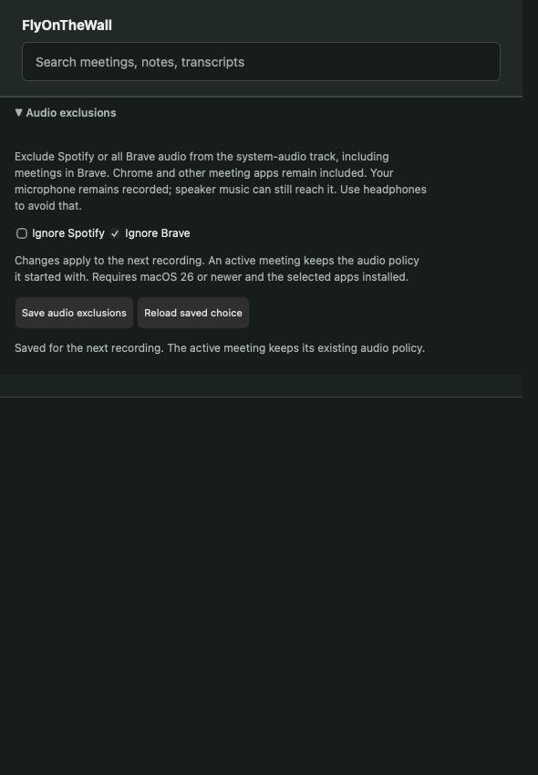

# Spotify and Brave exclusion settings progress

This follows #217 with independent opt-in Ignore Spotify and Ignore Brave
preferences in encrypted library settings. Both default off. Invalid saved
preferences refuse recording rather than widening capture. Authenticated GET/POST
handlers preserve the old policy on rejected writes; the UI keeps an unsaved
draft on failure and clearly labels preferences as next-recording changes.

Filtered Start currently requires macOS 26+ and an installed selected app.
Public installed-bundle metadata supplies main/helper identities without launching
applications or requiring them to be running. Missing/mismatched helper identities
refuse Start. Exact selectors, including helpers, reach the native descriptor;
process restoration is enabled. Unknown unrelated helper identities are rejected
rather than broadening an exclusion to another app.

The daemon freezes one system scope before speech configuration or capture.
Its supervised opener reuses that scope on every rebuild. `fotwd record` reads
the same saved preferences. Microphone capture is independent. Murmur remains
mic-only; headphones prevent speaker music entering either app's microphone.
Ignoring Brave also excludes meetings in Brave; Chrome remains eligible.

## Evidence and limits

Six settings-UI regressions were RED before implementation and are GREEN.
Encrypted in-memory persistence, malformed settings, unsupported policy, immutable
policy planning, installed helper metadata and authenticated API checks pass.
A device-free recorder test asserts invalid policy cannot open capture or configure
STT. Full local `just ci` passed: strict workspace lint, Rust tests/doctests,
157 UI tests, dependency checks and the Windows audio seam.

An owned nonpersistent WebKit window exercised actual checkbox/Save controls
against a synthetic loopback settings server at 590px. Defaults, both saved,
one independently disabled, reload, next-recording wording, Brave warning and
button bounds passed. The screenshot was visually inspected. This is UI evidence,
not native audio evidence; see [manifest](audio-exclusion-owned-ui/manifest.json).

Acceptance in #215 remains open. Outstanding work includes actual supervised
rebuild and downstream PCM/archive/STT/replay regression coverage, review of the
separate low-level `fotw` diagnostics capture path, and signed-app native playback,
helper churn, restart/rebuild and saved-audio/transcript qualification. No actual
Spotify/Brave audio was captured, and none of these tests prove system routing.
Installed-app updates introducing new helper identities during a recording also
need explicit enforcement/failure qualification. Do not claim whole-issue completion.
