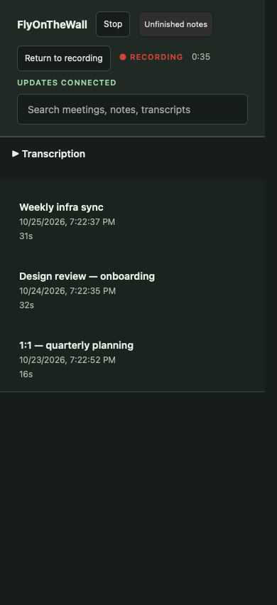
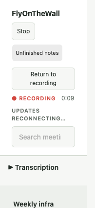

# Dashboard update connection status

The old green LIVE label meant that the dashboard's update socket was connected,
including when recording was idle. It now says Updates connected. A disconnected
socket displays Updates reconnecting… instead of hiding the indicator. Recording
state, elapsed time and Stop remain independent of the update connection.

A failed ticket POST previously ended recovery permanently. Ticket and socket
construction failures now schedule the same bounded-cadence reconnect as a closed
socket. Only one request/socket/retry can be active, every reconnect requests a
fresh ticket, and late events from the old socket cannot overwrite status or
apply stale frames.

Five regression-first Node cases cover idle wording, recorder controls during
disconnect, repeated ticket failure, fresh tickets, concurrent attempts, stale
socket events and constructor failure. All existing UI tests also pass.

An owned nonpersistent WebKit window ran the actual page and authenticated
WebServer with the existing synthetic recorder. Closing the actual socket and
injecting two ticket-request failures exercised recovery; recording, the clock
and Stop survived. The 390px dark connected and 195px light disconnected views
were inspected. Both preserve Stop without horizontal overflow. The smaller
viewport exercises narrow layout; it does not prove native zoom/focus behavior.
See [evidence manifest](dashboard-connection-owned-ui/manifest.json) and the
repeatable script alongside the screenshots.

Acceptance in #123 remains open. This is a focused status/reconnection follow-up
to the existing dashboard refresh, not full accessibility, focus, IME, physical
recording or whole-process memory qualification.
