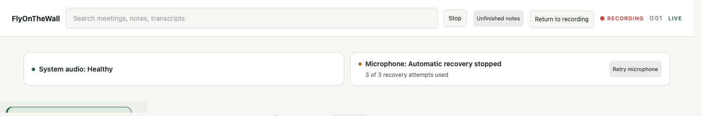
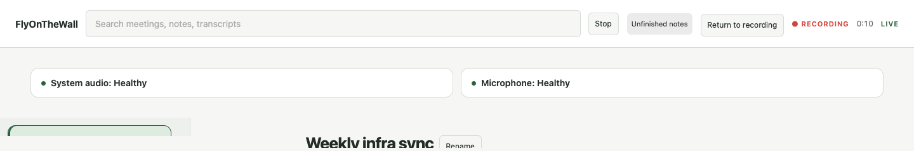

# Device recovery status (#121)

The shared capture supervisor retains its ineffective-rebuild count across brief
returns of audio. A ten-second run of frame and buffer progress, with audible
evidence since the last watchdog arm and no watchdog fault, resets the count.
The same confirmation releases quarantine while allowing incoming audio to
continue reaching the recorder. Empty callbacks, a poll without progress,
counter rollback, and observations separated by the starvation timeout restart
confirmation. Rebuilding or rearming also discards the previous confirmation.
This uses the injected capture clock; tests do not sleep or open audio devices.

Behavioral regression tests in `crates/fotw-audio/tests/watchdog.rs` first exposed
both immediate quarantine release and ten rebuilds from ten one-second bursts.
They now verify the configured ceiling, the ten-second boundary, interrupted
confirmation, and renewed recovery after sustained delivery. Run:

```sh
cargo test -p fotw-audio --test watchdog
just ci
```

Recovery attempts now share one episode across failed opens, successful starts
that do not restore sustained health, and route changes. The default is three
attempts, at least fifteen seconds apart; failed opens use capped exponential
backoff. Exhaustion cannot be reset by route chatter. `request_retry()` queues
an explicit new episode while preserving the original outage and spacing floor.
Stop or taking the tap cancels a queued retry and detaches the old notification
mailbox; reused supervisors need a new device watcher. Synthetic tests exposed
five default retries, a reset after brief success, and 167 open calls (including
initial startup) under route chatter before the fix. They verify mixed failures, successful route rebuilds,
manual retry/gap boundaries, and stopped-session notification isolation.

The legacy `Recovered` event remains the immediate format/gap boundary for
writers. Its user message now says restart is being confirmed; a separate
`DeliveryConfirmed` event fires once after sustained health. The supervisor also
exposes bounded, content-free delivery snapshots. A session-owned monitor carries
independent system/microphone state to the recording-status API and dashboard.
The dashboard keeps controls mounted across polls and distinguishes checking,
healthy, silent, recovering, exhausted and unavailable sources. Retry uses the
normal authenticated ingress and requires an exact active session ID plus an
exhausted source. Stop closes the monitor, discards pending requests and refuses
late publications; old browser responses cannot restore stopped/replaced state.

Tests cover source independence through the real pump adapter, authenticated
routing, stale session rejection, Stop, retry deduplication, preserved controls,
and late browser responses. A pending Stop immediately removes retry controls;
status polls cannot restore them until the stop request finishes.
`ui_preview --capture-recovery` offers a synthetic
browser fixture with a healthy system source and exhausted microphone. Retrying
moves it through checking to healthy without opening devices or providers.

Explicit device-invalidated, device-not-found and stream-format callback errors
now latch their first timestamp in a per-attempt atomic mailbox. Further PCM
from that faulted sink is refused. The next control poll enters recovery without
waiting for starvation; retries retain the existing episode budget and spacing.
Repeated errors cannot move the outage start, and an old sink's mailbox cannot
fault a replacement. An exhausted callback fault requires explicit retry; unlike
watchdog quarantine it cannot confirm health by accepting more suspect PCM.
The eventual recovery gap uses `callback-fault` and preserves the first fault
time even across exhaustion and manual retry.

`crates/fotw-audio/tests/callback_recovery.rs` first failed because explicit
callback faults still returned Healthy. Three synthetic tests cover prompt
rebuild, post-fault PCM refusal, old-error isolation, attempt spacing/ceiling,
Stop, and complete outage timestamps after manual retry. These checks do not
prove native teardown or callback quiescence. The wrapper observes reported
faults; it does not create missing native sample-rate notifications or implement
format conversion.

Each supervised attempt also owns an atomic callback admission flag. Retiring a
tap revokes new frame/error delivery before native Stop; detach for asynchronous
teardown and supervisor drop revoke it too. Failed startup revokes its retained
sink, and every fresh attempt gets a new flag. This prevents retired callbacks
from updating shared watchdog/session counters, reporting stale errors or adding
PCM after the attempt ends. It applies even to a healthy tap retired by watchdog
recovery, not only one that explicitly reported a fault.

Two behavioral regressions first demonstrated retired frames reaching the sink
and Stop accepting a second sample. Seven callback tests now cover faults,
budgets/gaps, retirement, Stop/detach/drop, failed initial/recovery starts,
callbacks emitted inside native Stop, and fresh-session delivery. The fence is
nonblocking: callbacks already admitted before revocation may finish. It is not
a native callback join, and does not replace physical teardown/quiescence checks.

This is partial implementation of #121. Quiescence of native callbacks already in flight,
sleep-aware gaps, recovery of a microphone
that failed its initial open, and bounded native recovery operations remain
required. Closing the mailbox cancels queued work; it cannot interrupt a native
operation already running. Native input format
validation does not itself implement live format notifications or conversion.
Signed-app device/sleep tests and full-pipeline persisted-audio checks remain
acceptance gates; synthetic supervisor tests do not prove them.

Native Chrome fixture check: the real dashboard showed healthy system audio
beside an exhausted microphone. Keyboard activation of Retry microphone changed
it to checking, then healthy after the fixture timer; system audio stayed
healthy. The owned preview tab, server and temporary library were removed.
This validates the browser flow, not physical device recovery or microphone
permissions. The full local suite includes 46 watchdog/recovery tests and 77 UI
tests; the final embedded-web unit suite also passes.

## Dashboard and API verification

The extracted workflow passed 46 watchdog, 22 recording API and 2 session-monitor
tests, all 80 browser unit tests, and full local `just ci`. Source-branch RED
regressions showed an immediate “recovered” announcement before health and a
missing exhausted-microphone UI. Strict Clippy and the synthetic preview build
also passed after the fixture was corrected to reset its episode budget.

An isolated, nonpersistent WebKit view exercised the real authenticated local API
against a temporary encrypted synthetic library. System audio remained healthy
while the microphone was exhausted; two synchronous clicks sent one retry POST.
The microphone moved through checking to healthy after ten seconds, its retry
budget reset to zero, and the retry button disappeared. Stop cleared the health
controls. A status poll preserved the mounted retry button and DOM focus. These
are synthetic browser checks; they do not establish physical keyboard focus,
native audio/device recovery, or a release-ready signed-app session.

The preview accepts either `--live-notes` or `--capture-recovery`; supplying both
is refused. Each fixture keeps its own recorder behavior. The images below show
only the source-health toolbar in that synthetic preview.





Review regressions reproduced two retry races: a poll discarded a current-session
retry error, and a queued-but-unconsumed retry became clickable again. The UI
now reports errors for the still-active recording independently of poll ordering.
An accepted retry stays disabled through old exhausted snapshots until delivery
state advances; a later exhausted episode can be retried again. A transition
observed before the POST reply also counts as acknowledgement. Stop and session
replacement still discard the old request.

Archive conversion and recovery ordering are described in [recovery-archive.md](recovery-archive.md).


### Native registration cleanup

macOS capture now explicitly calls Stop, unregisters its IOProc, drains the serial
callback queue, destroys an owned aggregate, then destroys its process tap. The
microphone follows the same registration lifetime without destroying the physical
device. A failed Start after registration follows the same teardown path.

A Stop error does not imply that capture continues: successful unregistration can
still prove capture stopped and permit full resource release. `TapError::Cleanup`
reports `Released`, `Stopped` (resources retained), or `Unconfirmed`. The optional
`AudioTap::stop_observed` notification reports confirmed capture cessation before
potentially slow resource cleanup; the result remains the cleanup acknowledgment.

Incomplete cleanup retains the callback/block/queue/device bundle until process
exit instead of freeing memory still referenced by native code. The supervisor
blocks both automatic and manual retry, and macOS fences later tap instances for
that source across recording sessions. The recording health panel asks the user
to reopen FlyOnTheWall. The other source can continue recording.

These tests inject registration/start/stop/unregistration/dependency failures;
they do not exercise real microphones, process-tap permissions, sleep/wake, or
physical USB/Bluetooth changes. Native calls remain synchronous and can block;
controller deadlines and ownership must be validated separately. The explicit
owner also covers process-tap UID/format lookup and aggregate construction before
callback registration. A failure there releases only acquired dependencies;
failed native release is returned alongside the setup error and fences that
source until restart. An aggregate enters the owner immediately after creation,
before callback/queue assembly. Preparation alone never starts capture. This does
not close the full device-recovery issue.


The partial-setup regressions first reproduced cleanup status being discarded
when a setup error escaped through Drop. Fixtures now cover UID/format/aggregate
setup errors, failed tap release, failed aggregate release (which must retain the
referenced tap), successful preparation without premature registration, and Drop
before Start. These inject native results through the same lifecycle used by the
macOS adapter; they do not open a real device or request permissions.
