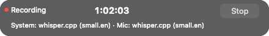

# Connected native recording controls

App-bundle serving launches and `fotwd shell` connect one AppKit shell to the
existing daemon and recorder. The dashboard remains the notes/library surface.
Native controls cannot be disabled by an app argument. Loose CLI serving keeps
its terminal behavior. This is source implementation with owned native evidence,
not installed-app or physical meeting acceptance. Acceptance in #58, #57 and
#124 remains open.

## Start, visibility and Stop

Menu and hotkey Start raise a fresh consent prompt. AppKit's actual checkbox
state must reach the host, and Start still requires acknowledgement at the
recorder boundary. The audit records the actual origin. Detection never starts
capture; the existing detector's automatic arming is not connected to this host
yet and remains follow-up work.

A four-command bounded queue, one Start worker and one retained status snapshot
keep recorder/configuration work off the AppKit thread. Each Start has its own
cancellation ticket; Stop and renderer acknowledgements use opaque exact-attempt
capabilities. Stale callbacks cannot authorize or stop a replacement attempt.

All dashboard/native starts reserve their attempt before configuration. The
native render gate requires an unchanged indicator, visible within a screen,
across an AppKit pump cycle before configuration or tap setup. Changed, hidden or
missing frames do not admit capture. Timeout, cancellation or a closed renderer
refuses it. AppKit is initialized on main while database, keys and daemon setup
run on workers. Native surfaces/global shortcuts are created only after the
process has daemon ownership; existing-daemon reentry creates neither.

The indicator follows actual preparing/starting/recording/finishing state,
capture time, source health and active speech engine/model/lag/errors. Unknown
clock or measured audio level stays unknown; it does not invent a timer or meter.
Opening old meetings or closing the browser does not change its recorder state.
Native Stop remains pending until recorder state acknowledges it.

## Ownership, reentry and Quit

An OS file lock in the canonical library directory excludes another daemon
regardless of port, session-subdirectory name or directory alias. Keep its inode:
normal shutdown releases the file handle rather than unlinking the lock. New Unix
lock files are private and symlink locks are refused. The guard is acquired before
keys/library/background work and shared with the native host.

The private atomic daemon state file additionally advertises native capability;
legacy CLI readers still read its unchanged port/token fields. If an older
browser-only daemon is running, its UI remains available and the new app explains
that it must finish/save and exit first. Finish and save its recording, quit the
old `fotwd` process in Activity Monitor, then reopen. A second native launch opens
a fresh authorized dashboard tab without creating another tray/hotkey owner.

Quit closes new Start admission and requests Stop without blocking AppKit. A
separate work lease covers configuration, capture and background persistence,
including a blocking finisher whose async waiter is cancelled. Idle alone never
means Saved. Quit waits for both live/native cleanup and these work owners.

A slow cleanup/save remains visible after the 30-second wait notice; the app
stays open and new recordings remain disabled. An unconfirmed or panicking save
requires a second explicit Quit acknowledging recovery is needed. No Saved claim
is fabricated. A stopped daemon disables Start and keeps a failure visible until
explicit Quit. Once capture/persistence drain, native/global resources are torn
down, server shutdown revokes background automatic output, and runtime teardown
has a two-second bound. Background enrichment is independent of the confirmed
audio save and may need to be retried after restart.

Menu actions run on a bounded background handler: Notes opens a fresh dashboard
handoff, Settings opens its available Transcription section, and Disclosure/About
open public static information. Handoff redemption keeps only allowlisted,
content-free settings anchors and removes the credential from the address bar.

## Owned native evidence

On macOS 26.4, two isolated examples exercised actual AppKit widgets without
launching the installed product, reading provider credentials, opening capture
devices, creating a tray or registering global hotkeys:

```sh
cargo build --locked -p fotw-shell --example indicator_frames
target/debug/examples/indicator_frames <owned-output-directory>
cargo build --locked -p fotwd --example native_consent_fixture
FOTW_JURISDICTION=US-CA target/debug/examples/native_consent_fixture <owned-output-directory>
```

The indicator fixture captures only its own view through AppKit's view bitmap
cache. These are simulated display states, not live ASR or captured meeting time.
All four panels retained nonactivating style, were on a screen, had controls
inside bounds and exact native text. Enabled Stop dispatched through AppKit;
unavailable measured level rendered no meter. Visual inspection found faint
secondary text; default vibrant text and a separate colored status dot fixed it.




The consent fixture feeds the actual `NativeHost` and bridge with a tap opener
that refuses capture. Menu and hotkey prompts both blocked unchecked Start,
delivered checkbox acknowledgement, enabled acknowledged Start, cleared the
prompt, audited the correct origin and drained on Quit. Configuration/capture
calls stayed at zero because no indicator was acknowledged. Results, all four
images and measured source hashes are in
[the owned-view manifest](native-shell-owned-views/manifest.json).

Behavioral RED/green tests cover renderer admission, consent, stale UI errors,
normal cancellation, visibility across pump cycles, ownership exclusion, and Quit
waiting for persistence after Idle. Additional tests cover finisher panic,
shutdown-before-Start, service failure visibility, old state-file compatibility,
and native Settings handoff routing. Existing recorder/shell regressions remain.

## Remaining acceptance

- Full repository/hosted checks and signed review-bundle results must accompany
  the final PR head; owned examples alone are insufficient release proof.
- Installed signed-app LaunchServices/TCC, actual global shortcuts, focus,
  fullscreen/spaces, scaling and screen-share behavior remain unvalidated.
- Actual microphone/system audio, USB/Bluetooth/sleep recovery, long meetings,
  provider/local fallback and concurrent-app laptop acceptance remain open.
- Automatic detector-to-native-prompt arming/snooze/suppression remains follow-up.
- Genuine AEC and broader model/provider quality/resource qualification remain
  separate roadmap work. No new models or user recordings were used here.
